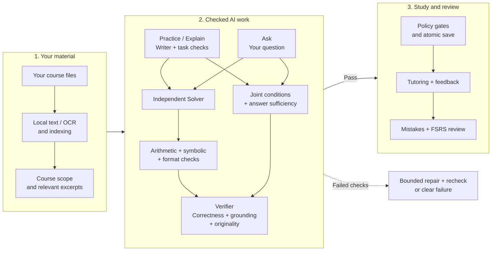

# Study Desk

Study from your own course documents in a local desktop workspace. Bring your AI
provider key; your files and study history stay on your computer.

## Install the desktop application

Current release: [0.2.17 beta](https://github.com/LeymansGuz/Study-Desk/releases/tag/v0.2.17-beta.3).
No Python, Node.js or `.env` setup is needed for the installers.

| Computer | Download |
|---|---|
| Windows 10/11 x64 | [Setup executable](https://github.com/LeymansGuz/Study-Desk/releases/download/v0.2.17-beta.3/Study-Desk_0.2.17_x64-setup.exe) |
| Apple Silicon Mac, macOS 14+ | [Apple Silicon DMG](https://github.com/LeymansGuz/Study-Desk/releases/download/v0.2.17-beta.3/Study-Desk_0.2.17_aarch64.dmg) |
| Intel Mac, macOS 14+ | [Intel DMG](https://github.com/LeymansGuz/Study-Desk/releases/download/v0.2.17-beta.3/Study-Desk_0.2.17_x64.dmg) |
| Linux x64 | [DEB](https://github.com/LeymansGuz/Study-Desk/releases/download/v0.2.17-beta.3/Study-Desk_0.2.17_amd64.deb) · [AppImage](https://github.com/LeymansGuz/Study-Desk/releases/download/v0.2.17-beta.3/Study-Desk_0.2.17_amd64.AppImage) |

**Windows:** run the installer, then open **Study Desk** from the Start menu.

**macOS:** open the DMG, drag **Study Desk** into **Applications**, eject the DMG,
then open the app. The beta is not Apple-notarized. For a trusted official download
blocked as an unidentified developer, try opening it once, then go to
**System Settings → Privacy & Security → Open Anyway**.
See [Mac troubleshooting](docs/TROUBLESHOOTING.md#macos-blocks-the-app) if it still will not open.

**Linux DEB:** open the file with your package manager, or run:

```bash
sudo apt install ./Study-Desk_0.2.17_amd64.deb
```

**Linux AppImage:** make it executable in file properties, or run:

```bash
chmod +x ./Study-Desk_0.2.17_amd64.AppImage
./Study-Desk_0.2.17_amd64.AppImage
```

Linux builds target Ubuntu 22.04. Other distributions may need WebKitGTK,
Secret Service/KWallet or FUSE setup; see [Linux troubleshooting](docs/TROUBLESHOOTING.md#linux-dependencies-or-fuse).
[Checksums](https://github.com/LeymansGuz/Study-Desk/releases/download/v0.2.17-beta.3/SHA256SUMS.txt)
and build manifests accompany the release.

### First launch

1. Open **Study Desk** and review the data-use notice.
2. In **Settings → AI connection**, save your provider key, choose a model
   (and hosting endpoint if shown), then save the connection.
3. Add course files in **Workspace**, wait for indexing, and start studying.

DeepSeek Flash is the tested paid baseline. Free models support **brief concept
explanations only**. AI features need internet access unless you configure a suitable
local model server. Local embeddings may download their model on first use.

Need a key? [Get an API key for your provider](docs/API-KEYS.md).

### Updates inside the app

Open **Settings → App updates → Check for updates → Download update**.
When study work and indexing are idle, choose **Install and restart**.
Updates verify the package and create a data backup first. Cached blocks reduce
repeat downloads when possible; a full verified download is the fallback.

Apple Silicon launch has user-reported device testing. All four targets passed
native CI checks; Intel Mac and Linux device testing is still pending.

## Features

- **Practice a topic:** course-grounded questions, four difficulty levels,
  automatic checked maths figures and a three-stage concept mastery path.
- **Seven question types:** multiple choice, short answer, calculation,
  long answer, essay, proof/derivation and true/false.
- **Explain a concept:** brief or deep explanations, worked examples,
  source references, recall checks and one-click practice.
- **Ask a question:** your own text or attachments, local OCR,
  part-by-part feedback and hints tailored to your answer.
- **Workspace:** drag/drop and screenshot paste, background indexing,
  original-file previews, per-file/bulk document types, safe replacement and course scope controls.
- **Review:** verified question bank, bank-only mock exams with paper summaries,
  verified mistake retries, FSRS flashcards and Anki export.
- **Progress:** daily study queue, exam countdown, course plans and next-topic suggestions.
- **Study library:** revision sheets, checked course guides, combined saved-work/document search,
  page notes, bookmarks and course/personal-study import/export.
- **Local controls:** light/dark themes, separate saved provider keys,
  token/cost statistics, backups, encrypted exports and signed in-app updates.

## How the study pipeline works



Failed checks withhold the result; automated checks cannot guarantee correctness.
[Pipeline details and repetition rules](docs/AI-AND-PIPELINE.md) ·
[Measured reliability, timings and estimated costs](docs/RELIABILITY-AND-COST.md)

## Help and documentation

- **Using the app:** [User guide](docs/USER-GUIDE.md) · [Troubleshooting](docs/TROUBLESHOOTING.md)
- **Running the source:** [Source setup](docs/SOURCE-SETUP.md)
- **Development:** [Contributing](CONTRIBUTING.md) · [Desktop builds and releases](DESKTOP.md)
- **Policies:** [Privacy](PRIVACY.md) · [Usage terms](TERMS.md) · [Licensing and notices](THIRD-PARTY-NOTICES.md) · [Security](SECURITY.md)

AI requests send relevant study content to your selected provider. API charges
come from your provider account; Study Desk has no application subscription.
Report problems through [GitHub Issues](https://github.com/LeymansGuz/Study-Desk/issues),
without including keys, private notes or personal information.
